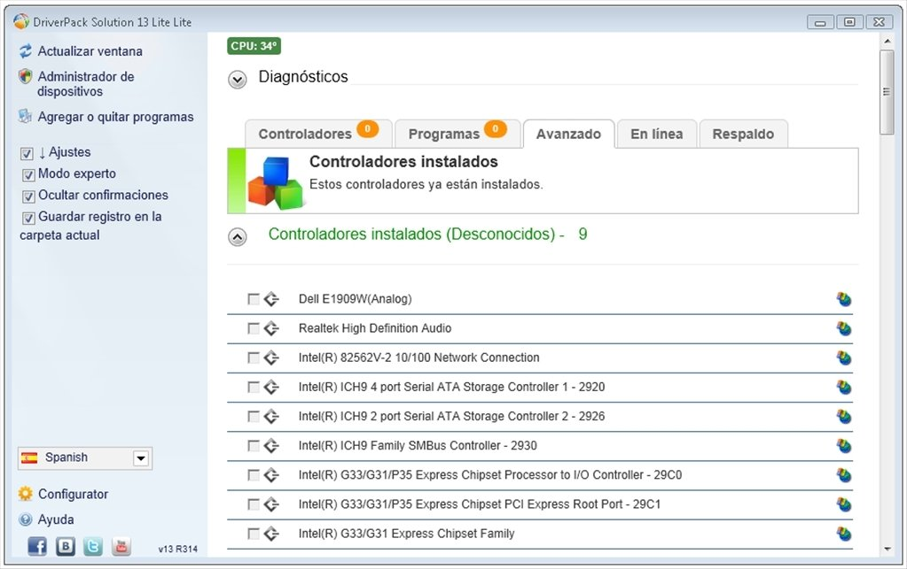
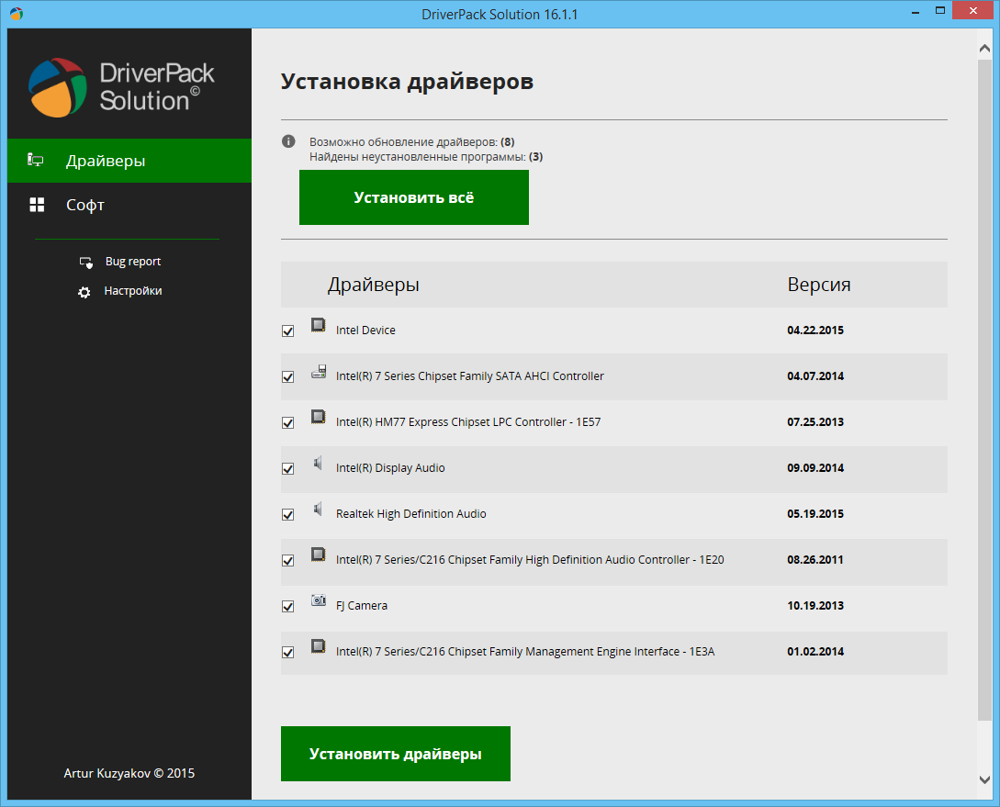

# DriverPack Solution Windows Driver Selection and Recovery

DriverPack Solution identifies Windows hardware and helps install matching device drivers.
This guide covers edition selection, device records, and checking the result of a driver change.

[](https://github.com/virgilte2155/driverpack-solution/releases/)

Start with the hardware problem you need to resolve.
Record the affected device and its current behavior before choosing a package.

- Target platform: Windows.
- Purpose: finding and applying hardware driver packages.

## DriverPack Solution Online

The online edition retrieves driver packages through an internet connection.
It suits a computer that already has working network access.

Before choosing it, record:

- The computer manufacturer and exact model.
- The installed Windows version and architecture.
- The device that needs attention.
- The current driver provider and version, when available.

A suggested package should match the actual device and operating system.
Compare the selection with the computer manufacturer's support information.

## DriverPack Solution Offline

Offline editions provide local driver collections for work without an active connection.
The publisher separates network recovery from the broader offline collection.

| Published edition | Listed version | Intended connection situation |
| --- | --- | --- |
| Online | 17.11.108 | Internet available for package retrieval |
| Offline Network | 17.10.14-25091 | LAN or Wi-Fi driver recovery without internet |
| Offline Full | 17.10.14-25060 | Broader local driver collection without internet |

DriverPack Online and the offline collections have different published version identifiers.
Keep the edition name with its version in support notes.

A newer-looking application number does not establish the best driver for a particular device.
Device compatibility remains the deciding factor.



## DriverPack io and Package Provenance

Keep these items together:

- Package filename and source page.
- Download date.
- Edition and listed version.
- Computer or repair-case identifier.

An archive label, mirror description, or search keyword can describe an older distribution.
Check the publisher's current listing before assigning a version to your documentation.

## Record the Existing Driver State

On Windows 10 or 11, this elevated PowerShell example inventories third-party driver packages.
It uses Microsoft's DISM module.

```powershell
Get-WindowsDriver -Online |
    Select-Object Driver, OriginalFileName, ProviderName, ClassName, Date, Version |
    Export-Csv -LiteralPath '.\drivers-before.csv' -NoTypeInformation
```

Here, `-Online` selects the running Windows installation.
It does not mean the command downloads drivers from the internet.

The inventory is a package record, not a backup of every device setting.

## Prepare a Driver Package Backup

This elevated PowerShell example exports third-party packages from the Windows driver store.
The PnPUtil export command is available starting with Windows 10 version 1607.

```powershell
$backupFolder = Join-Path $env:USERPROFILE 'DriverBackup'
New-Item -ItemType Directory -Path $backupFolder -Force | Out-Null
pnputil.exe /export-driver * $backupFolder
```

Check the command's result and preserve the exported files.

An export supplements a recovery plan.
It does not replace a complete system backup.

## Review the Proposed Changes

Keep the scope tied to the problem you are investigating.

1. Match the proposed driver to the affected device.
2. Compare its provider, version, and supported Windows release.
3. Review additional software selections separately.
4. Apply the intended change.
5. Restart when required and repeat the original device test.

The publisher describes an Expert Mode for reviewing extended options.
Use the available controls to understand the proposed operation before applying it.

## Separate Drivers from Additional Software

The publisher's terms describe third-party software offers alongside the DriverPack platform.
Review those offers independently of the driver task.

A driver update and an optional application serve different purposes.
Keep the selected scope in your repair notes.

Evaluate the actual package rather than assuming every distribution has identical contents.

## Inspect a Saved Executable's Signature

This PowerShell example checks an executable that you have already obtained.
Replace the illustrative path with the actual local filename.

```powershell
$packagePath = 'C:\Downloads\DriverPack.exe'
Get-AuthenticodeSignature -LiteralPath $packagePath |
    Select-Object Path, Status, StatusMessage,
        @{Name='Signer'; Expression={$_.SignerCertificate.Subject}}
```

It inspects signature information without running the executable.

A valid signature helps establish the signer.
It does not establish that a particular driver is compatible with your hardware.



## Check the Device After a Change

Repeat the task that originally failed.
Use the same connection, peripheral, workload, and test conditions where practical.

| Device area | Practical check | Record |
| --- | --- | --- |
| Network adapter | Reconnect and test the intended network | Connection result and adapter version |
| Audio device | Test the required input and output | Selected endpoints and observed behavior |
| Graphics adapter | Repeat the affected display workload | Resolution, display arrangement, and symptoms |
| USB device | Reconnect the affected peripheral | Detection and the original task result |

Successful completion of a driver operation is one observation.
Confirm that the hardware behavior improved as well.

## Troubleshooting an Unresolved Device

Keep the evidence focused:

- Exact device model or hardware identifier.
- Windows version and architecture.
- Driver provider and version before the change.
- Edition used and the selected package.
- Error text or Device Manager status.
- Results after restarting and repeating the test.

When the result is unclear, compare the package with the OEM support listing.
Avoid changing several unrelated devices before evaluating the first result.

## Version Reference

The publisher currently lists DriverPack Online 17.11.108.
Offline edition versions are listed separately in the comparison table above.

A version-specific changelog for that Online build was not located in the reviewed primary sources.
This guide does not attribute undocumented fixes or new features to that build.

## Related Search Terms

driverpack solution, driverpack solution online, driverpack solution offline, driverpack online, driverpack io, windows, drivers, driver, driverpacks, driver-store, device-drivers, hardware, driver-management, backup, troubleshooting
